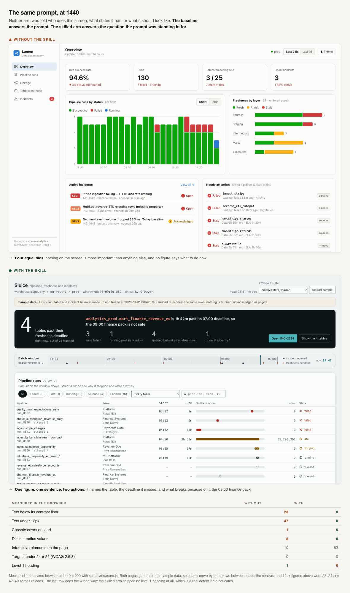

# skills


**Eight skills that make Claude Code check its own work.** Each one adds a
habit a careful engineer already has. Open the running app before you call a
screen done. Read a component's licence before you ship it. Write down every
limit the user set before a long run. Get a second reviewer before you hand
work over.

## Proof first: one prompt, built twice

> Build a data platform observability console. It should show pipeline runs,
> data lineage, table freshness, and incidents.

Same model, same prompt. One arm ran on a stock install. The other arm had
`design-the-ui`. A browser measured both pages at 1440 px:

| Measured in the browser | Without | With `design-the-ui` |
|---|---|---|
| Text below its contrast floor | 23 | 0 |
| Text under 12 px | 47 | 0 |
| Console errors on load | 1 | 0 |
| Level 1 heading | 1 | 0 (a miss) |

The last row went the wrong way, and it stays in the table. The stock page shows four
equal tiles. The skilled page leads with one fact: four tables are late, so
the 09:00 finance pack is not safe. The skilled arm also found eight
false statements in its own interface, which no linter reports.



This is one run per arm, not a benchmark, and it ran an earlier version of
the skill, then named `ui-design`. The method, the phone-width
results and every caveat are in
[the A/B write-up](shared/docs/research/ab-test.md).

## What backs it

- 173 offline tests pass for the `design-the-ui` scripts. Run
  `bash ui/design-the-ui/tests/run.sh` to check.
- 42 curated design sources, each with a reuse tier. Each licence was
  read at the source. See [`sources.json`](ui/design-the-ui/sources.json).

The reuse tiers tell the agent what it may copy:

| Tier | Sources | What the agent may do |
|---|---|---|
| `use` | 25 | Copy, change and ship it (MIT, Apache-2.0, Unlicense) |
| `credit` | 1 | Use it with attribution (CC-BY-4.0) |
| `check-licence` | 12 | Tell you about the condition before anything ships |
| `inspiration` | 3 | Take direction only. No code, no assets |
| `browse-only` | 1 | Never fetch it. You browse it and paste in what you want |

## The skills

| Skill | Say | What it does |
|---|---|---|
| [`design-the-ui`](ui/design-the-ui/SKILL.md) | "Make the pipeline health screen modern" | Writes `DESIGN.md` first. Offers three directions and stops until you pick one. Builds, then opens the running app, measures it and fixes what it finds |
| [`find-a-component`](ui/find-a-component/SKILL.md) | "Find me a timeline with expandable logs" | Searches your project, then 11 curated registries, then the public shadcn registry directory. Reads the real code and licence before it ranks a candidate |
| [`review-the-ui`](ui/review-the-ui/SKILL.md) | "Is this ready to ship?" | Measures the live page, walks the journey and reports each harm with evidence and severity. Changes no files unless you ask |
| [`tear-it-apart`](review/tear-it-apart/SKILL.md) | "Would a tech lead approve this?" | Builds a coverage matrix, runs a fresh reviewer, fixes what it finds, and asks before each further round |
| [`check-the-instruction`](review/check-the-instruction/SKILL.md) | "Check this rule before I add it" | A fresh reviewer tests a change to CLAUDE.md, a rule, skill, hook or setting, and returns the wording to apply |
| [`remember-my-words`](orchestration/remember-my-words/SKILL.md) | "Work on this while I'm away" | Writes each constraint you state to a file, so it survives long runs and compaction |
| [`grill-the-implementation`](orchestration/grill-the-implementation/SKILL.md) | "Grill the implementation" | Questions how an agreed plan gets built (API or webhook, storage, auth, failure) and writes the decisions down for the tickets |
| [`who-builds`](orchestration/who-builds/SKILL.md) | "Hand this ticket to a sub-agent" | Picks opus, sonnet or haiku for each sub-agent, writes the brief for that model, and sends the result to an opus review |

Each skill starts on its own when the work matches its description. You can
also call it by name.

`split-the-work` moved to the colony plugin,
[Dhodraj/colony](https://github.com/Dhodraj/colony). Call it as
`colony:split-the-work`.

## Install

Install one skill with [APM](https://github.com/microsoft/apm):

```bash
apm install -g Dhodraj/skills/ui/design-the-ui
```

Change the path for another skill. Add `#<commit>` to pin a version.

Without APM, clone the repo and copy a skill folder into `~/.claude/skills/`.

The UI skills need Node 20 or newer. The full setup is in
[install and invoke](shared/docs/guides/install-and-invoke.md).

To try one in five minutes, install `review-the-ui`, start your web app, and
ask Claude Code: "Review the main screen of this app." It changes no files.

Some skills call skills from other packages:

| Skill | Needs | From |
|---|---|---|
| `grill-the-implementation` | `grilling`, `domain-modeling`, `to-tickets` | [mstack](https://github.com/Dhodraj/mstack) |
| `who-builds`, `check-the-instruction` | `writing-for-agents` | [mstack](https://github.com/Dhodraj/mstack) |
| `check-the-instruction` | The skill-writing playbook in `poteto-mode`, when the change is a skill | [pstack](https://github.com/Dhodraj/pstack) |
| `tear-it-apart` | Optional: `interrogate`, for code where only run-proven findings count | [pstack](https://github.com/Dhodraj/pstack) |

If a needed skill is missing, the calling skill does that step itself, tells
you which skill was missing, and installs nothing.

## Limits

The skills are instructions, not mechanisms. An agent that skips a step still
passes every automated check. The [ui README](ui/README.md#limits) lists what
is not tested yet.

## Contributing

Issues and pull requests are welcome. Read
[CONTRIBUTING](.github/CONTRIBUTING.md) and the
[code of conduct](.github/CODE_OF_CONDUCT.md) first. To report a security
problem, follow [SECURITY](.github/SECURITY.md) and do not open a public issue.

## Licence

MIT, see [LICENSE](LICENSE). [NOTICE](ui/design-the-ui/NOTICE) lists every
source the UI skills adapted, with its licence.
