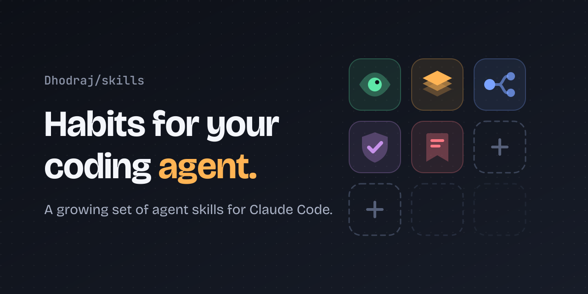

# skills



**Your agent says "done". These skills make it show you.**


Eleven skills for Claude Code. Each one adds a habit that a careful engineer
already has, and that a coding agent skips when nobody tells it otherwise.

## The difference

| You ask | A stock agent | With the skill |
|---|---|---|
| "Build the pipeline health screen" | Writes the page and says it is finished | Takes your brand, builds three live variants for you to pick from in the browser, writes `DESIGN.md`, then opens the running page, measures it and fixes what it finds ([`design-the-ui`](ui/design-the-ui/SKILL.md)) |
| "I need a timeline with expandable logs" | Writes a new one from scratch | Searches your project and the component registries, and reads the code and licence before it suggests one ([`find-a-component`](ui/find-a-component/SKILL.md)) |
| "Is this ready to ship?" | Reads the code and says yes | Measures the live page, walks the journey and lists each harm with evidence ([`review-the-ui`](ui/review-the-ui/SKILL.md)) |
| "Would a tech lead approve this?" | Reviews its own work and approves it | Builds a coverage matrix and gives the work to a fresh reviewer who did not write it ([`tear-it-apart`](review/tear-it-apart/SKILL.md)) |
| "Add this rule to CLAUDE.md" | Adds it | Has a fresh reviewer test the rule for overlap, conflict, load and need first ([`check-the-instruction`](review/check-the-instruction/SKILL.md)) |
| "Work on this while I'm away" | Forgets a limit you set after the context is compacted | Writes every limit you state to a file that it reads again later ([`remember-my-words`](orchestration/remember-my-words/SKILL.md)) |
| "The plan is agreed, write the tickets" | Guesses API or webhook, storage and auth | Asks you about each open technical choice and writes the answers down first ([`grill-the-implementation`](orchestration/grill-the-implementation/SKILL.md)) |
| "Give this ticket to a sub-agent" | Runs every sub-agent on its own model, whatever the task | Picks opus, sonnet or haiku for each task and has opus review the result ([`who-builds`](orchestration/who-builds/SKILL.md)) |

Each skill starts on its own when the work matches its description. You can
also call it by name.

## Three kits

| Kit | Skills | For |
|---|---|---|
| [ui](ui/README.md) | `design-the-ui`, `match-the-prototype`, `find-a-component`, `review-the-ui` | Building and reviewing a product interface. The before-and-after test is in this README |
| [review](review/README.md) | `tear-it-apart`, `check-the-instruction` | Checking work before it is handed over |
| [orchestration](orchestration/README.md) | `remember-my-words`, `grill-the-implementation`, `who-builds`, `keep-a-wiki`, `pass-the-ticket` | Keeping long or parallel agent work on track |

`split-the-work` is now in the colony plugin,
[Dhodraj/colony](https://github.com/Dhodraj/colony).

## Install

Install one skill with [APM](https://github.com/microsoft/apm):

```bash
apm install -g Dhodraj/skills/review/tear-it-apart
```

Change the path for another skill. Add `#<commit>` to pin a version. Without
APM, clone the repo and copy a skill folder into `~/.claude/skills/`. The full
setup is in [install and invoke](shared/docs/guides/install-and-invoke.md).

Some skills call skills from [mstack](https://github.com/Dhodraj/mstack) or
[pstack](https://github.com/Dhodraj/pstack). Each kit README lists them. If a
needed skill is missing, the calling skill does that step itself and tells
you.

## Limits

The skills are instructions, not mechanisms. An agent that skips a step still
passes every automated check. Each kit README lists what is not tested yet.

## Contributing

Issues and pull requests are welcome. Read
[CONTRIBUTING](.github/CONTRIBUTING.md) and the
[code of conduct](.github/CODE_OF_CONDUCT.md) first. To report a security
problem, follow [SECURITY](.github/SECURITY.md) and do not open a public issue.

## Licence

MIT, see [LICENSE](LICENSE).
