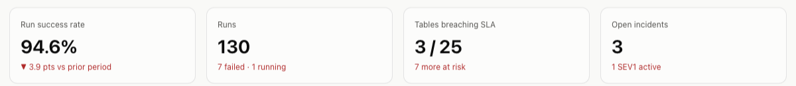
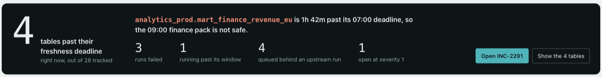

# ui

Skills for building and reviewing a product interface. They make a coding
agent decide what a screen is for before writing it, write the design system
down before building against it, and open the running product before calling
it done. Install them as the [repository README](../README.md#install) shows.

## Model-invoked

A model-invoked skill starts on its own when the work matches its description.
You can also name it.

- [`design-the-ui`](design-the-ui/SKILL.md): design or redesign a surface, from the
  design system up. Eleven stages, one of them a hard stop.
- [`match-the-prototype`](match-the-prototype/SKILL.md): build or check a screen against
  its approved prototype, state by state, by measuring both sides.
- [`find-a-component`](find-a-component/SKILL.md): find a component that already exists, in the
  project or in the shadcn-spec registries, instead of writing a new one.
- [`review-the-ui`](review-the-ui/SKILL.md): review an interface that exists, or what
  a change did to one. Measures the live render and walks the journey.

## User-invoked

None. No skill here sets `disable-model-invocation`, because each one carries
a trigger description that says when it applies.

## What design-the-ui does

Eleven stages that scale to the size of the change. A copy edit runs two of
them and then looks at the result. A new surface runs all eleven, with the
look picked by eye from live variants before any code is written.

| | |
|---|---|
| 0 to 1 | Read what exists. Find or write `DESIGN.md`, and gate it with `pnpm dlx @google/design.md lint` |
| 2 to 3 | Name the business outcome and criteria checkable in a browser. Take the brand from the live site, its repo or a brand file; with none, show a gallery of thirteen styles in the client's own name, colour and font, for the user to pick one or two. Build three structurally different live variants with the `prototype` skill, inside a product mock, and stop until the user picks one in the browser |
| 4 to 5 | Map the journey. Components and the full list of states wait for the composition |
| 6 to 7 | A new look goes through the mock; build direct only where the look is set. Compose the whole screen in one pass, then swap in the product's components and build every state. A screen an approved prototype draws goes to `match-the-prototype` |
| 8 to 9 | Start the application, walk it as the customer with real clicks and typing, check it against the gates and the craft rules, measure, fix in severity order, check for regressions |
| 10 | Report what was verified, by what means, and what was not |

One of those stages is a hard stop. On a new surface, the agent does not
build past a look that nobody picked.

## The same prompt, with and without the skill

> Build a data platform observability console. It should show pipeline runs,
> data lineage, table freshness, and incidents.

Same model, same prompt. Once on a stock install, once with `design-the-ui`.
This is the first thing each screen tells an on-call engineer.

**Without the skill:** four equal tiles. No tile says what to do now.



**With the skill:** one fact, the reason it matters, and two actions.



A browser measured both pages at 1440 px:

| Measured in the browser | Without | With |
|---|---|---|
| Text below its contrast floor | 23 | 0 |
| Text under 12 px | 47 | 0 |
| Console errors on load | 1 | 0 |
| Level 1 heading | 1 | 0 (a miss) |

The last row went the wrong way. This is one run per arm, not a benchmark,
and it ran an earlier version of the skill. The full screens, the method and
every caveat are in
[the A/B write-up](../shared/docs/research/ab-test.md).

## Sources and what the agent may copy

42 curated design sources, each with a reuse tier. Each licence was read at
the source. See [`sources.json`](design-the-ui/sources.json), and
[NOTICE](design-the-ui/NOTICE) for every source the skills adapted.

| Tier | Sources | What the agent may do |
|---|---|---|
| `use` | 25 | Copy, change and ship it (MIT, Apache-2.0, Unlicense) |
| `credit` | 1 | Use it with attribution (CC-BY-4.0) |
| `check-licence` | 12 | Tell you about the condition before anything ships |
| `inspiration` | 3 | Take direction only. No code, no assets |
| `browse-only` | 1 | Never fetch it. You browse it and paste in what you want |

The skills need Node 20 or newer. 173 offline tests cover the
`design-the-ui` scripts: run `bash ui/design-the-ui/tests/run.sh`.

## Component discovery

Search the project first, then the shadcn-spec registries, with no account
and no MCP server. After install, the script is in the `design-the-ui` skill
folder. Run it by its full path, so it works from any folder:

```bash
node ~/.claude/skills/design-the-ui/scripts/find-components.js \
  timeline stepper activity --limit 10
```

```
@uiarc     timeline   13  not stated on the site's pages that were read
    Follow what happened, newest first, grouped by day.
   deps: lucide-react, motion; files: 2
    read: pnpm dlx shadcn@latest view @uiarc/timeline
@reui      timeline   13  MIT
   deps: @base-ui/react, cn; files: 1
    read: pnpm dlx shadcn@latest view @reui/timeline
searched 24 registries for: timeline, stepper, activity
licences marked "check at the source" were not read; read one before shipping a component
```

The score is a text match, not a judgement. Candidates are then read: their
real code, states, keyboard handling, dependencies and licence. They are
ranked by fit, licence, stack, design system, accessibility and install cost,
in that order. A component with no stated licence does not ship until the
user decides.

## The design system comes first

A review with no stated principles is taste, and taste loses arguments. So
`design-the-ui` writes the principles down before it builds, into one `DESIGN.md`
at the project root, and `review-the-ui` measures against that file.

Two layers. Tokens in YAML, which the linter and the Tailwind export read.
Then ten prose sections, carrying what tokens cannot: the mood, the
guardrails, what happens at a phone width, and the brief a future agent
gets.

```bash
pnpm dlx @google/design.md lint DESIGN.md      # broken refs, missing primary,
                                          # any colour pair below 4.5:1
pnpm dlx @google/design.md export --format css-tailwind
```

Two routes in. Where the project already has tokens, a theme or a live
product, the file **records what is there**. Values come out of the code, or
off the rendered page as computed values. Never estimated from a screenshot.
Where there is nothing, the file is a proposal, and stays marked as one until
the user picks a variant.

## The demo

Look at the demo yourself:

```bash
cd ../shared/demo/console && python3 -m http.server 8731
# then open http://127.0.0.1:8731/console.html
```

`shared/demo/console/console-plain.html` is the same console before the craft pass. Put them
side by side.

## Limits

- The gates and the craft rules are instructions, not mechanisms. An agent
  that skips those files still passes every automated check. `DESIGN.md` is
  the only part with a linter behind it.
- Nothing can force the three variants to differ in structure. Three shades
  of one idea would pass the stage.
- The Storybook path in `review-the-ui` has not been run against a real
  Storybook.
- `pnpm dlx @google/design.md lint` has not been run against a file these
  skills generated. The one at `shared/demo/ab/with-skill/DESIGN.md` was written
  without network access.
- No component has been installed into a project through `find-a-component`, and no
  application with a dev server, sign-in and live data has been driven.
- Walking a journey is not customer research. It finds friction. It says
  nothing about what customers do.

Every figure, run, depot and customer in `shared/demo/` is sample data, and the pages
say so on their own face.
